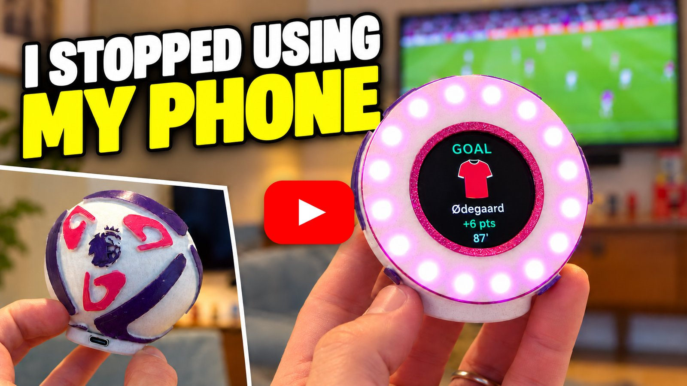
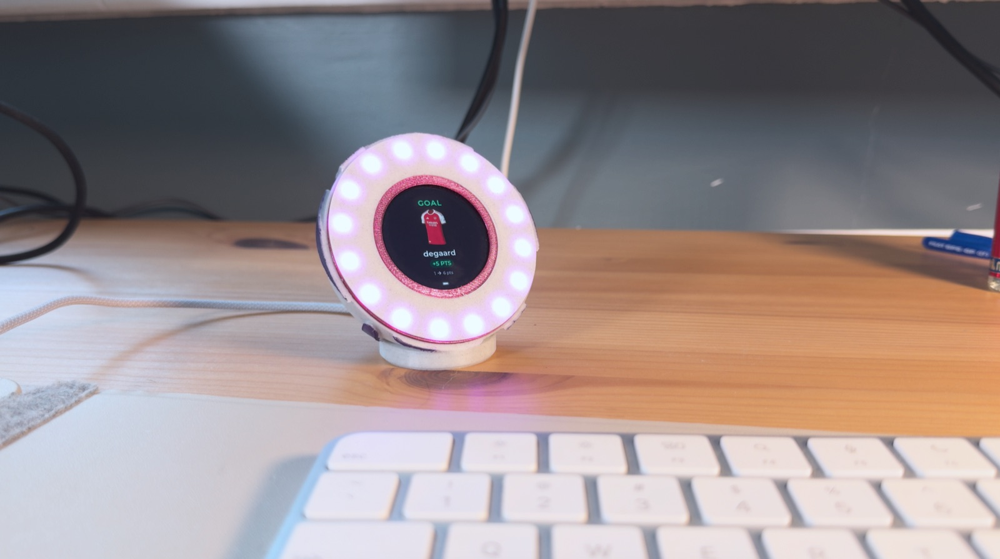
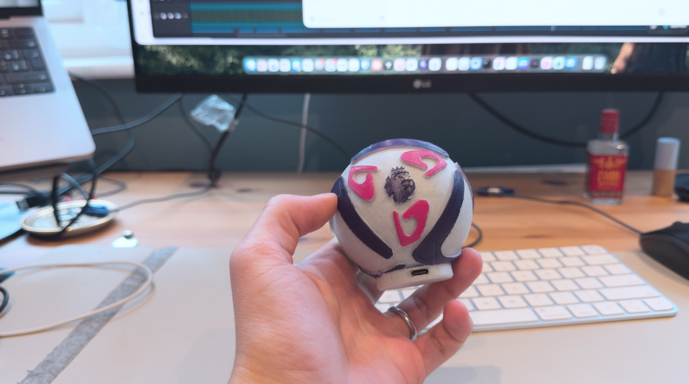

# FPL Buddy

A live Fantasy Premier League tracker for your desk. A 3D-printed Premier League ball holds a round touch display and
an LED ring. It shows your gameweek points, rank and player events as they happen. Between gameweeks it cycles through
your rank history, price changes and mini leagues.

<p align="center">
  <a href="https://www.youtube.com/watch?v=uSBmQau3X9I">
    
  </a>
  <br>
  <b>▶️ <a href="https://www.youtube.com/watch?v=uSBmQau3X9I">Watch the full build on YouTube</a></b>
</p>

<p align="center">
  
  
</p>

## Build your own

- ⚽ **3D printing files (free):** [Printables](https://www.printables.com/model/1871032-fpl-live-tracker)
- 🖥️ **Display:** [Waveshare ESP32-S3-Touch-LCD-1.46](https://www.amazon.co.uk/dp/B0GQB3CFM1), a 412×412 round touch screen
- 💡 **LED ring:** [WS2812 addressable LED ring, 16 LEDs](https://www.amazon.co.uk/dp/B0DF59W3SY)
- 🧵 **Filament:** [Elegoo Marble PLA](https://www.amazon.co.uk/dp/B0CM6C7W84)

The LED ring's data line goes to **GPIO 13** by default (`FPL_LED_RING_PIN` in `include/fpl_config.h`).

### More from me

- 🎥 **YouTube:** [Nvkvmakes](https://www.youtube.com/@Nvkvmakes)
- ❤️ **Patreon**, for extra CAD files and supporting future projects: [patreon.com/nvkvmakes](https://patreon.com/nvkvmakes)
- 📸 **Instagram**, for more mechanisms, electronics and things I make: [@nvkv.makes](https://www.instagram.com/nvkv.makes/)

## What it does

### During a live gameweek

The display cycles through:

- **Live score:** your gameweek points and live overall rank.
- **Points events:** what each player scored from. **Clear** hides old events so only new ones show.
- **Squad:** each player's live points, with your captain marked and the bench below.
- **Mini leagues:** live ranks in each of your mini leagues.
- **Rank graph:** your rank history, ending on your live overall rank.

When one of your players scores, assists, keeps a clean sheet, gets bonus points, a card and so on, a pop-up shows
the event with the club's kit and the points, and the LED ring flashes purple. Tap the latest-event card on the live
score to jump to the events list.

### Between gameweeks

The display cycles through your overall rank, a rank history graph, predicted price changes for your squad, price
changes for players on your watchlist, and your mini-league ranks. Screens with nothing to show are skipped.

In the last 6 hours before a deadline the display switches to a countdown, and in the final hour to a full-screen
countdown ring.

### Touch

- **Tap** to go to the next screen. Tapping the left third of the screen goes back. Each screen gets the full
  interval (30 s by default) after you land on it. Long lists scroll a screenful at a time before moving on.
- **Hold for 7 seconds** to start setup mode (see [Connect it to WiFi](#2-connect-it-to-wifi)). A countdown ring
  appears after 2 seconds; let go to cancel.

### LED ring

- **Rank trend:** green if your overall rank went up since the last gameweek, red if it went down, off if it didn't
  change.
- **Deadline countdown:** in the last hour before a deadline the ring turns purple and one LED goes out every 3.75
  minutes. It turns red for the last 15 minutes.
- **Player events:** a purple flash with each pop-up.

Brightness for each of these, and when the rank trend shows, can be changed in the [web UI](#web-ui).

### Battery

The firmware supports a LiPo battery on the board's battery connector. On battery, press the board's **PWR** button
to switch it on. It keeps running when you unplug USB, and the display shows a battery icon. On USB the icon reads
near full whether or not a battery is fitted. To switch it off on battery, run `device off` over serial.

## Setup

### 1. Flash the firmware

Install [PlatformIO Core](https://docs.platformio.org/en/latest/core/installation/index.html), or the PlatformIO
extension for VS Code. The board definition is included in `boards/`, and the first build downloads the ESP32 platform
and libraries (LVGL 9, ArduinoJson 6, Adafruit NeoPixel).

```bash
git clone https://github.com/ivannson/fpl-buddy.git
cd fpl-buddy
pio run -t upload        # build and flash the firmware
pio run -t uploadfs      # upload the club kit images in data/ to the board
pio device monitor       # optional: serial log and commands (115200 baud)
```

The kit images are uploaded separately from the firmware. Without them the event pop-ups still work, but show no
shirt. When you only change code, `pio run -t upload` is enough.

### 2. Connect it to WiFi

You don't need to put your WiFi details in the firmware. If none are saved, the device starts in **setup mode**: it
creates a WiFi network called `FPL-Buddy-XXXX` and shows a QR code for it on the display. Scan the code or join the
network from your phone, and a setup page opens where you choose your WiFi network and enter your FPL team ID. The
device then restarts and joins your network.

It also goes into setup mode if it can't connect to the saved WiFi after booting (about 45 s), and restarts to try
again after 10 minutes with nobody connected to it. To start setup mode yourself, for example to move the device to a
new WiFi network, **hold the screen for 7 seconds**. Holding for 7 seconds in setup mode leaves it again.

### 3. Find your FPL team ID

On the [FPL site](https://fantasy.premierleague.com/), open the **Points** tab. The address looks like
`https://fantasy.premierleague.com/entry/1234567/event/7`. The number after `/entry/` is your team ID.

### Optional: build in your own defaults

You can build default WiFi details and a team ID into the firmware, so the device skips setup mode on first boot.
Settings saved from the web UI take priority over these.

- **WiFi:** create `include/wifi_config.h`. Git ignores this file, so your password isn't committed.

  ```cpp
  #pragma once

  #define WIFI_SSID     "YOUR_WIFI_NAME"
  #define WIFI_PASSWORD "YOUR_WIFI_PASSWORD"
  ```

- **Team ID:** set `FPL_ENTRY_ID` in `include/fpl_config.h`.

## Web UI

Once the device is on your WiFi, open **http://fpl-buddy.local**, or the IP address shown on the display and printed
by the `device` serial command. Some Android phones can't open `.local` addresses; use the IP address instead.

From the **Settings** tab you can:

- change the screen interval, rank graph range, price watchlist and which mini leagues are shown
- set the LED ring brightness for the rank trend, the deadline countdown and event flashes (each as a percentage of
  `FPL_LED_RING_MAX_BRIGHTNESS`), and limit the rank LEDs to a live gameweek and/or a match in play
- change the FPL team ID and WiFi network
- set a password for the page (user name `admin`). Without one, anyone on your network can open it. To remove a
  forgotten password, run `device password clear` over serial.
- see the firmware version and install new firmware: upload `.pio/build/esp32-s3-touch-lcd-146/firmware.bin`
- restart the device, or restart it in setup mode

### Demo mode

The **Demo** tab drives the display with made-up FPL data, so you can show any screen without waiting for a real
matchday (useful for filming). Start it with your own team (as last polled) or a built-in sample squad. FPL polling
pauses while the demo runs. **Stop demo**, or restarting the device, brings back your live data.

- **On the display:** jump to the live score, events list or squad, or to any between-gameweeks screen. You can also
  pause the carousel on one screen.
- **Gameweek:** between gameweeks, a deadline in 5h 59m (deadline countdown), 59m 50s (final hour and LED ring), down
  to 10 s, or kick off. With "Go live when the deadline passes" on, the countdown runs out and the next gameweek goes
  live, as it would after a real deadline.
- **Score and rank:** set the gameweek, points, overall rank and rank change, nudge the rank up or down (this sets
  the LED ring colour), or mark the data as stale.
- **Player events:** pick a player and add a goal, assist, clean sheet, saves, bonus, card, own goal and so on. The
  display shows the same pop-up, with kit and LED flash, as a real update. By default the rank moves with the points.
- **Scenes:** pre-set sequences (deadline to kick-off, matchday highlights, rank rollercoaster, deadline day,
  between-gameweeks tour) that play without you touching anything. Keep the page open while one runs.

The between-gameweeks screens get demo data too: a rank history that ends at the demo rank, and price changes for the
squad and watchlist that include a rise, a fall, no change and a locked price. Mini leagues are your real ones, or
sample leagues if you have none.

## Serial commands

Open the serial monitor (`pio device monitor`, 115200 baud) and type `help` for the full list. Changes to screens,
the watchlist and leagues are saved to flash.

```text
screens                        show current settings
screens interval 20            seconds per screen (5-600)
screens graph all              rank graph range: 3, 5, 10 or all
screens reset                  restore the fpl_config.h defaults
watch                          list watched players and their price status
watch add saka                 watch a player by web name or ID (up to 8)
watch remove saka | watch clear
league                         list mini leagues with their IDs
league hide 98809 | league show 98809 | league show all

device                         WiFi, web UI address, firmware version
device setup                   restart in setup mode
device password clear          remove the web UI password
device restart
device off                     switch off (on battery; USB keeps it running)
device battery                 battery voltage and level
```

For development there are also `demo`, `gw` and `event` commands (a serial version of the Demo tab), `fps`, and
`screenshot [page]`.

## Configuration

Defaults live in `include/fpl_config.h`. The main ones:

| Setting | Default | What it does |
|---|---|---|
| `FPL_ENTRY_ID` | set your own | FPL team ID used on first boot. Change it later in the web UI. |
| `FPL_POLL_INTERVAL_MS` | 60 s | How often it polls FPL while a match is in play |
| `FPL_IDLE_POLL_INTERVAL_MS` | 10 min | How often it polls otherwise. It still wakes for the next kickoff or deadline. |
| `FPL_IDLE_SCREEN_INTERVAL_SEC` | 30 | Seconds per screen (5-600) |
| `FPL_RANK_GRAPH_GAMEWEEKS` | 5 | Gameweeks on the rank graph: 3, 5, 10, or 0 for all |
| `FPL_DEFAULT_WATCHLIST` | `"Saka"` | Watched players for price changes, comma-separated web names or IDs (up to 8) |
| `FPL_LED_RING_ENABLED` | 1 | Set to 0 if you have no LED ring |
| `FPL_LED_RING_PIN` | 13 | LED ring data pin |
| `FPL_LED_RING_LED_COUNT` | 16 | Number of LEDs on the ring |
| `FPL_LED_RING_MAX_BRIGHTNESS` | 64 | Hardware brightness cap (0-255). The web UI brightness settings are a percentage of this. |
| `FPL_LED_RING_DEFAULT_ANIMATION` | 2 | Rank trend animation: 0 breathing, 1 rotating dim LED, 2 comet |

Screen, watchlist, league and LED settings are first-boot defaults. Once you change them in the web UI or over serial,
the saved values take priority. The file also has cache times and JSON/PSRAM buffer sizes for the FPL API; you
shouldn't need to change them.

Settings wrapped in `#ifndef` can also be set from `build_flags` in `platformio.ini`, for example
`-D FPL_LED_RING_PIN=5`.

## Updating club kits

Kit images live in `data/kits/` as raw 110×145 RGB565 files named `<team>_<outfield|gk>_110x145.rgb565`. To make
new ones from PNGs, for example for a new season:

```bash
pip install pillow
python scripts/convert_kits.py path/to/kit-pngs              # outfield kits
python scripts/convert_kits.py path/to/kit-pngs --type gk    # goalkeeper kits
pio run -t uploadfs
```

Name each PNG after the club (`arsenal.png`, `man-united.png`, `nottingham-forest.png`). The script maps common club
names to the names the firmware uses. Add `--preview <folder>` to also save PNG previews of the converted kits.

## Project layout

| Path | Contents |
|---|---|
| `src/main.cpp` | FPL polling, screens, pop-ups, serial commands and demo mode |
| `src/ui_kit.cpp` | Colours, fonts and the shared UI components the screens are built from |
| `src/web_server.cpp`, `include/web_ui_html.h` | Web UI and firmware upload |
| `src/device_config.cpp` | WiFi, team ID and web UI password, saved to flash |
| `src/display_settings.cpp` | Screen, watchlist, league and LED settings, saved to flash |
| `src/led_ring.cpp` | LED ring animations |
| `src/power.cpp` | Battery power latch and battery voltage |
| `lib/SPD2010/` | Display and touch driver |
| `boards/` | PlatformIO board definition for the Waveshare board |
| `data/kits/` | Club kit images, uploaded with `pio run -t uploadfs` |
| `scripts/convert_kits.py` | Converts kit PNGs for `data/kits/` |
| `api_test/` | Python scripts that check the FPL API against what the firmware expects (see [api_test/README.md](api_test/README.md)) |

## Status

This is **v1** (firmware 1.0.0).

### To do

- Fix the layout of the between-gameweeks screens so text isn't cut off at the edges of the round display.
- Smoother animations when switching between screens.
- Confirm the price change rule (projected progress reaching ±100%) against real price changes
  (`api_test/price_changes.py`).

## Hardware history

FPL Buddy started on the Sunton ESP32-2424S012C (ESP32-C3) and moved to the Waveshare ESP32-S3-Touch-LCD-1.46:

- **Dual-core ESP32-S3:** graphics run on one core and FPL polling on the other.
- **More memory and PSRAM:** HTTPS and JSON parsing are more stable, and display buffers can be larger.
- **412×412 round display:** more room for the screens.

The old `esp32-2424S012C` environment is still in `platformio.ini` for reference, but it isn't maintained.
